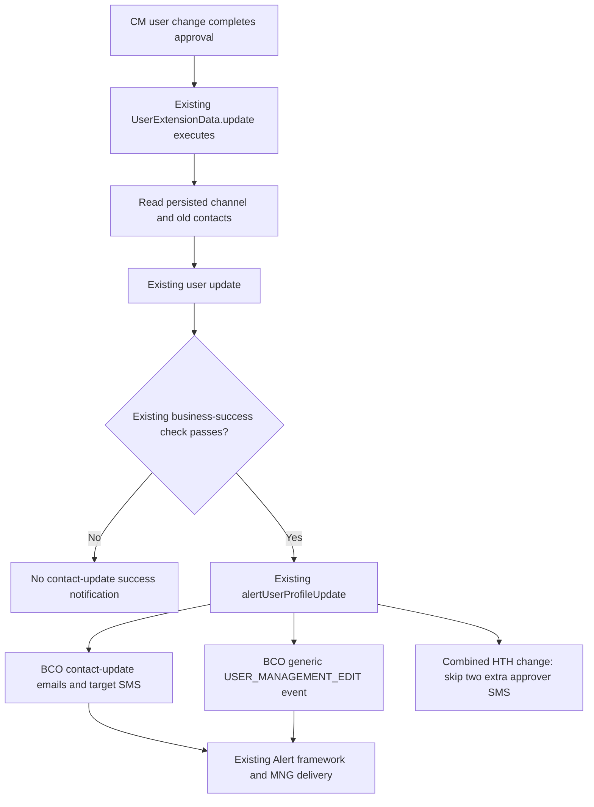

# BCOH2H-2110 — Combined Email and Mobile update notification

Revised: 2026-11-04. Scope: an existing HTH user's email and mobile number are **both changed** in CM.

## 1. Agreed outcome

Use the existing BCO notification events, templates and recipient flow. Remove only the two additional target-specific SMS reminders previously copied to the HTH final approver. Keep BCO's generic user-edit notification, including its existing approver/company routes.

This clarification supersedes the earlier proposal to create private `HTH_2110_*` events, eighteen templates and a separate completion callback. It does not change HTH email-only/mobile-only behavior, ordinary BCO, PIN state-change notifications or API Password Code approval.

## 2. Notifications retained

| Existing Event ID | Channel / content | Existing recipient flow retained |
|---|---|---|
| `INFO_UPDATE_BY_CORP_ADMIN` | Email: email address and mobile number updated | Target's old email, target's new email, company officeEmail and final approver email. All use the existing external-recipient flow. |
| `CORPORATEPLUS_WELCOME_MAIL` | SMS: welcome / mobile registration | Target's new mobile. Existing `.create` activity mapping is retained. |
| `USER_MOBILE_NUMBER_UPDATED_REMINDER` | SMS: mobile number changed | Target's old mobile. **Do not also copy this reminder to the approver.** |
| `USER_EMAIL_ADDRESS_UPDATE` | SMS: email address changed | Target's new mobile. **Do not also copy this reminder to the approver.** |
| `USER_MANAGEMENT_EDIT` | Generic user-edit email / SMS | Existing BCO configuration derives recipients and chooses templates. The log carries the executing session user ID and company/target information. In the normal CM flow the session user is the final approver. Retain the configured user/company routes. |

No new template text, language fallback, subscriber mapping or delivery-count rule is introduced. Template IDs, content and enabled channels come from the existing database mappings. Do not force the corporate-user template onto a company route. Query Q1 in the verification SQL shows the actual mappings for each recipient type and locale.

With distinct addresses, the contact-update method registers four explicit email notices, three explicit target SMS notices and one generic `USER_MANAGEMENT_EDIT` event. The generic event can produce further messages according to database configuration; registration counts are not delivered-message counts. Missing contacts, configuration and existing deduplication can affect results.

## 3. Processing and data sources



- Keep the existing upstream approval flow and notification timing inside the successful user update. No new post-commit callback or request-local completion marker is required.
- Old email is copied by the existing HTH helper before persistence; old mobile is captured by the existing update method. Reusing a managed entity must not replace these old values.
- New contacts come from the approved update request. Company email/name come from existing party preferences.
- The existing HTH helper resolves the final signed approver for explicit contact-update email. The generic BCO event still uses session user ID, as before; it is not rewritten to a new recipient mechanism. Background/OMB execution identities must be verified in that environment if used.
- Keep the existing success-code handling and PIN change gates. A contact-only update must not be turned into a PIN reset disablement notification.

## 4. Minimal implementation

| File | Final change |
|---|---|
| `HthProfileApproverNotification.java` | Return no additional approver SMS when both contact fields changed. Three added lines including comments. Existing single-field behavior remains. |
| `UserExtensionData.java` | Restore the existing notification-method call and old-contact/approver capture; remove the 2110 diversion and deferred snapshot. Preserve the current 880 activation-after-success change. |
| `CZTransactionExt.java` | Remove the one 2110 callback call. No new approval logic. |
| `HthContactUpdateNotification.java`, `HthContactUpdateApprovalLifecycle.java` | Delete the two unnecessary 2110 classes, including their marker and reflective module bridge. |
| Original 2110 template-creation SQL | Remove it from this delivery. Reuse existing BCO configuration; no replacement DML is required. |
| Tests and verification SQL | Replace the private-route tests with the existing BCO-path comparison and a combined-contact regression; retain read-only environment queries. |

No changes to batch jobs, dispatchers, common packages, DTOs, frontend or BCO templates. The shared notification method is restored without changes to its body.

## 5. Existing behavior checked

| Check | Finding |
|---|---|
| Old email after managed-object update | Existing pre-save HTH snapshot retains both old and new email destinations. Regression passed. |
| Reused activity/detail objects | The repository SDK serializes ActivityData when registering. The local test uses that SDK snapshot operation and observes separate destinations. No additional object-copy mechanism is needed for this inspected path. |
| Generic approver notification | Existing `USER_MANAGEMENT_EDIT` registration remains. Only the two additional contact-specific approver SMS are suppressed. |
| Deduplication | Preserve existing rules: explicit HTH approver email is compared with emails already in that contact-event list, ignoring case and recipient suffix. There is no new global deduplication across all recipients, events or transactions. Different events can still reach the same mailbox/phone. |
| Country code and dispatcher overrides | Existing BCO routing remains. Old/new numbers in different countries and environment-specific recipient override lists need UAT verification; this change does not claim to fix those shared behaviors. |

## 6. Validation and deployment

Local validation passed:
- Execute the production notification method and compare ordinary BCO behavior for email-only, mobile-only, both and no-op cases against the pre-change baseline.
- Execute combined HTH changes with the CM final approver as session user: same BCO events, explicit recipients and business template inputs; three target SMS retained and two extra approver SMS absent.
- Check old/new email snapshots, existing email deduplication, single-field SMS routing, success/failure gates and PIN hook behavior using repository SDK classes with bank-data/transport fixtures.
- Compile restored SMS and approval classes against repository dependencies for Java 8; run existing API Password approval/rejection regression.

Run from the full source checkout with `JAVA_HOME` set:

```sh
python3 devtools/backend-compile/tests/verify_hth_2110.py
```

Deployment:
1. Build/deploy the SMS and approval modules from the same revision. A clean build must exclude the two deleted classes; the approval class no longer invokes the old callback.
2. **No database update is required. Do not re-run the superseded 2110 template-creation SQL.** If it was already executed, its private mappings can remain unused; this delivery does not delete database configuration or notification history. Old binaries or already queued old messages may still refer to those IDs.
3. Use `2_HTH_Contact_Update_Verification.sql` to inspect the active BCO mappings, dispatcher configuration and messages for a new final approval. Existing private configuration rows alone do not mean the new code uses them.
4. UAT must confirm actual final approval and email/SMS delivery. Expect the two target-specific events to reach the target only; the approver's generic user-edit notification remains subject to existing BCO configuration. Reconcile messages by time, event and recipient, not just total count.

Local tests do not establish live Oracle configuration or actual inbox/handset delivery.

## 7. Source and isolated mcdp delivery

Commit/push source changes and synchronize only this story under `mcdp-h5-demo-int/bcohth-2110/hhfi/`, preserving source-relative paths. Keep root mcdp `consulting` unchanged. `DELETED_FILES.txt` lists the obsolete files to remove when applying an earlier overlay; `SHA256SUMS` verifies the current overlay files. Existing 876/881 work is outside this delivery.
